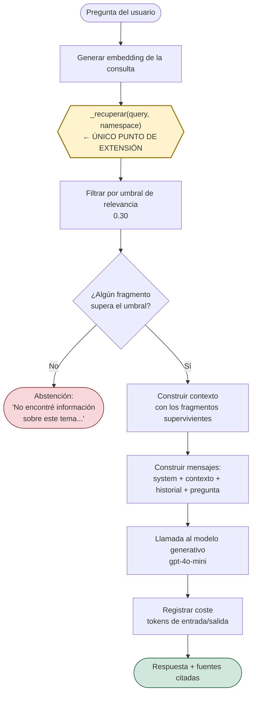
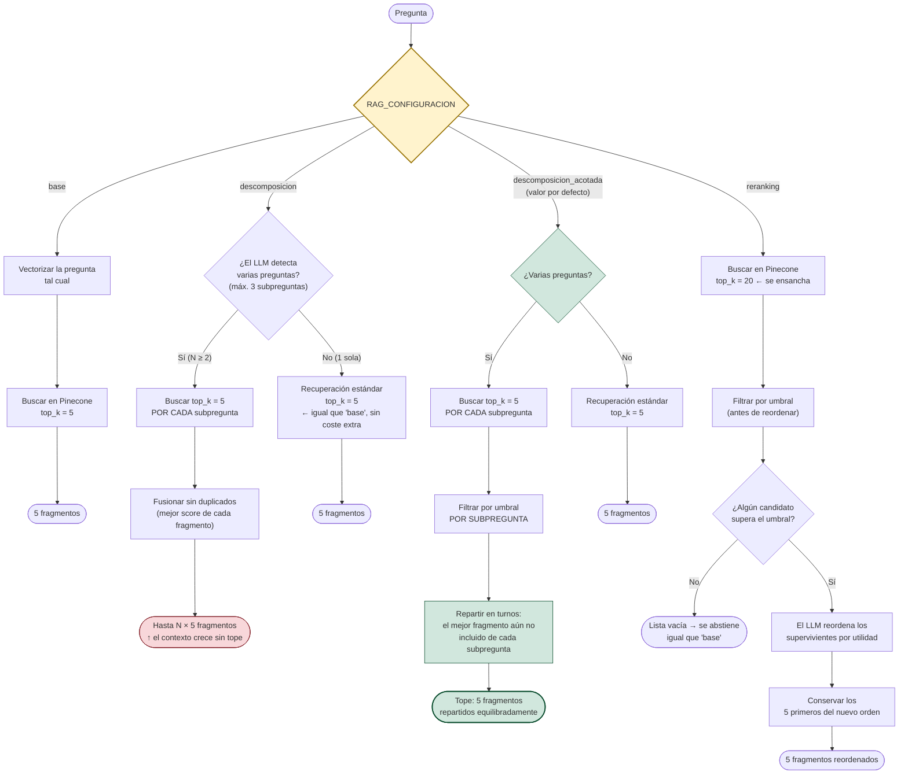
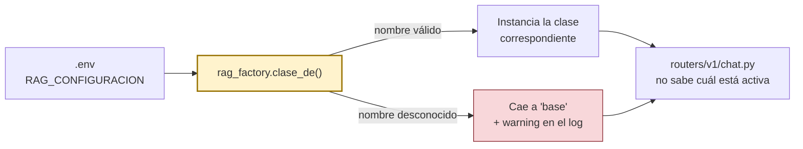

# Diagrama de flujo — pipeline RAG

Material de defensa. Dos vistas complementarias del mismo sistema:

1. **El esqueleto compartido** — lo que `generate_response()` hace siempre,
   igual en las cuatro configuraciones.
2. **El único punto de extensión** — qué hace cada configuración dentro de
   `_recuperar()`, que es lo único que cambia entre ellas.

Los valores (`TOP_K=5`, umbral `0.30`, etc.) son los **valores por defecto**
de `app/core/config.py`; los cuatro son parametrizables por variable de
entorno. Ver `COMO_ARRANCAR.md` para cómo seleccionar la configuración activa.

---

## 1. El esqueleto compartido (Template Method)

Todo lo de aquí vive **una sola vez** en `RAGService.generate_response()` y se
hereda sin modificar. El único rombo que varía por configuración es
`_recuperar()` — ver la sección 2.

**Lo que hay que señalar si preguntan por el umbral:** el filtro (paso D) es
**posterior** a `_recuperar` y **común** a las cuatro configuraciones. Ninguna
estrategia de recuperación puede saltárselo — es la garantía de que la
abstención se comporta igual sin importar cuál esté activa.

---

## 2. Dentro de `_recuperar()` — las cuatro configuraciones

Esto es lo que cambia. `rag_factory.py` instancia una de las cuatro clases
según `RAG_CONFIGURACION`; cada una reimplementa `_recuperar` de forma
distinta y el resto del pipeline (sección 1) no se entera de cuál está activa.

**Las tres frases que hay que tener listas si preguntan "¿por qué esa y no
otra?":**

- **`base`** es la línea base: el término de comparación de todo el
  capítulo 5. Nunca se modifica, para que la comparación siga siendo posible.
- **`descomposicion`** demuestra el techo de la mejora (cobertura del 48 % al
  88 % sobre las seis parejas medidas), pero **sin tope**: con 2 subpreguntas
  ya duplica el contexto y el coste.
- **`descomposicion_acotada`** es la que está activa. Resuelve el mismo
  problema — ninguna subpregunta se queda sin representación (desequilibrio de
  1,83 a 0,83) — **sin** aumentar el presupuesto de 5 fragmentos.
- **`reranking`** mejora la recuperación de forma medible (hit@3 de 0,50 a
  0,67), pero las métricas de generación no se movieron fuera del margen de
  ruido del juez, y multiplica el coste ×3,7. Queda medido y documentado, no
  activo.

---

## 3. Cómo se seleccionan en producción

El router de chat llama a `crear_rag_service()` y usa el resultado como un
`RAGService` cualquiera — no necesita saber cuál de las cuatro clases recibió.
Cambiar de configuración es cambiar una variable de entorno, nunca tocar
código.
