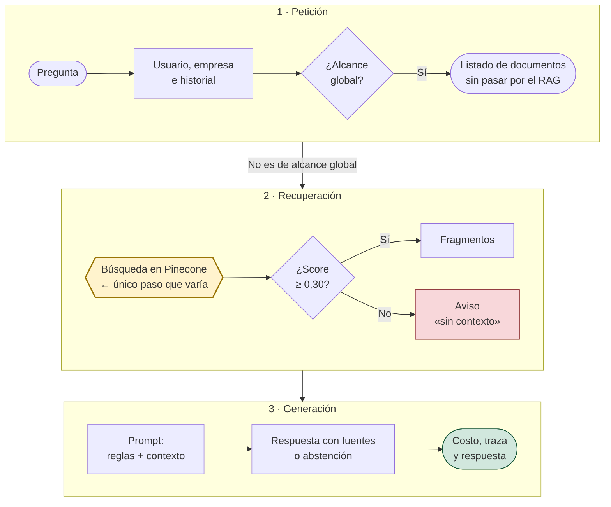
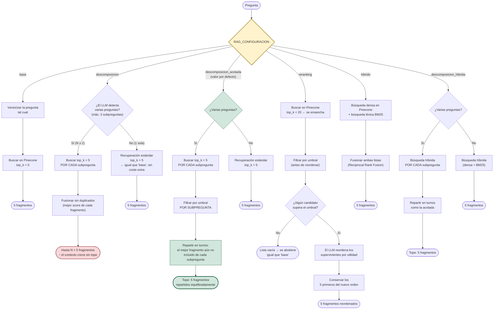
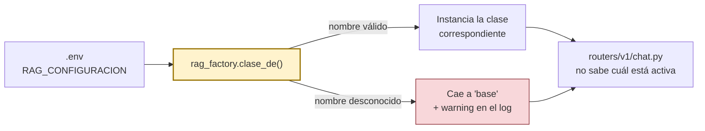

# Diagrama de flujo — pipeline RAG

Material de defensa. Dos vistas complementarias del mismo sistema:

1. **El recorrido completo de una consulta**: lo que el chat hace siempre,
   igual en todas las configuraciones. Es el diagrama de la memoria (3.2).
2. **El único punto de extensión** — qué hace cada configuración dentro de
   `_recuperar()`, que es lo único que cambia entre ellas.

Los valores (`TOP_K=5`, umbral `0.30`, etc.) son los **valores por defecto**
de `app/core/config.py`; los cuatro son parametrizables por variable de
entorno. Ver `COMO_ARRANCAR.md` para cómo seleccionar la configuración activa.

---

## 1. El recorrido completo de una consulta

Este es el diagrama del apartado 3.2 de la memoria. Todo lo que no sea
`_recuperar()` vive **una sola vez** en `routers/v1/chat.py` y en
`RAGService` (`_preparar_generacion` y `_build_messages`) y es común a todas
las configuraciones. El único paso que varía es la recuperación, resaltado en
amarillo; la sección 2 lo detalla.

**Lo que hay que señalar si preguntan por la abstención:** cuando ningún
fragmento supera el umbral, el sistema **no se salta el modelo**. Le envía un
aviso explícito de que no hay contexto, y es el modelo el que se abstiene,
porque las reglas del prompt se lo ordenan. Se hace así porque un contexto
vacío y silencioso invita al modelo a rellenarlo con conocimiento propio. El
filtro del umbral (rombo «¿Score ≥ 0,30?») es **posterior** a la recuperación y **común** a todas las
configuraciones: ninguna estrategia de recuperación puede saltárselo.

---

## 2. Dentro de `_recuperar()` — las seis configuraciones

Esto es lo que cambia. `rag_factory.py` instancia una de las seis clases
según `RAG_CONFIGURACION`; cada una reimplementa `_recuperar` de forma
distinta y el resto del pipeline (sección 1) no se entera de cuál está activa.

**Las frases que hay que tener listas si preguntan "¿por qué esa y no
otra?":**

- **`base`** es la línea base: el término de comparación de todo el
  capítulo 5. Nunca se modifica, para que la comparación siga siendo posible.
- **`descomposicion`** demuestra el techo de la mejora (cobertura del 48 % al
  88 % sobre las seis parejas medidas), pero **sin tope**: con 2 subpreguntas
  ya duplica el contexto y el coste.
- **`descomposicion_acotada`** es la que está activa. Resuelve el mismo
  problema — ninguna subpregunta se queda sin representación (desequilibrio de
  1,83 a 0,83) — **sin** aumentar el presupuesto de 5 fragmentos.
- **`reranking`** mejora la recuperación de forma medible (hit@3 de 0,50 a
  0,67), pero las métricas de generación no se movieron fuera del margen de
  ruido del juez, y multiplica el coste ×3,7. Queda medido y documentado, no
  activo.
- **`hibrido`** es la que mejor encuentra el fragmento correcto (hit@1 de 0,25
  a 0,42), pero busca con la pregunta completa y baja la cobertura de las
  preguntas de dos temas del 48 % al 30 %. **`descomposicion_hibrida`** la
  sube al 37 %, sin llegar a la base, y es la más lenta. Ninguna está activa:
  retroceden justo en las preguntas compuestas.

---

## 3. Cómo se seleccionan en producción

El router de chat llama a `crear_rag_service()` y usa el resultado como un
`RAGService` cualquiera — no necesita saber cuál de las seis clases recibió.
Cambiar de configuración es cambiar una variable de entorno, nunca tocar
código.
